# Hi, I'm Ognjen 👋

Computer Engineering student at the **University of Agder** in Norway.
I like working close to the hardware (sensors, RTOSes, kernels) and also the tooling that ships it.

## 🔧 Stack

## 🐍 Contributions, eaten

<picture>
  <source media="(prefers-color-scheme: dark)" srcset="https://raw.githubusercontent.com/ognjendrazic/ognjendrazic/output/github-snake-dark.svg" />
  <source media="(prefers-color-scheme: light)" srcset="https://raw.githubusercontent.com/ognjendrazic/ognjendrazic/output/github-snake.svg" />
  
</picture>
